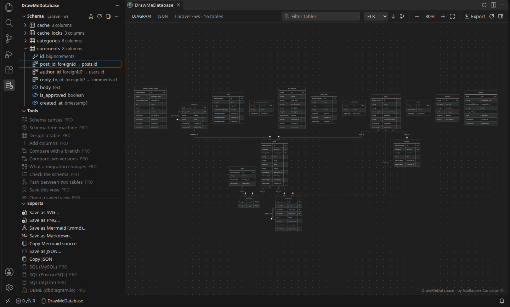
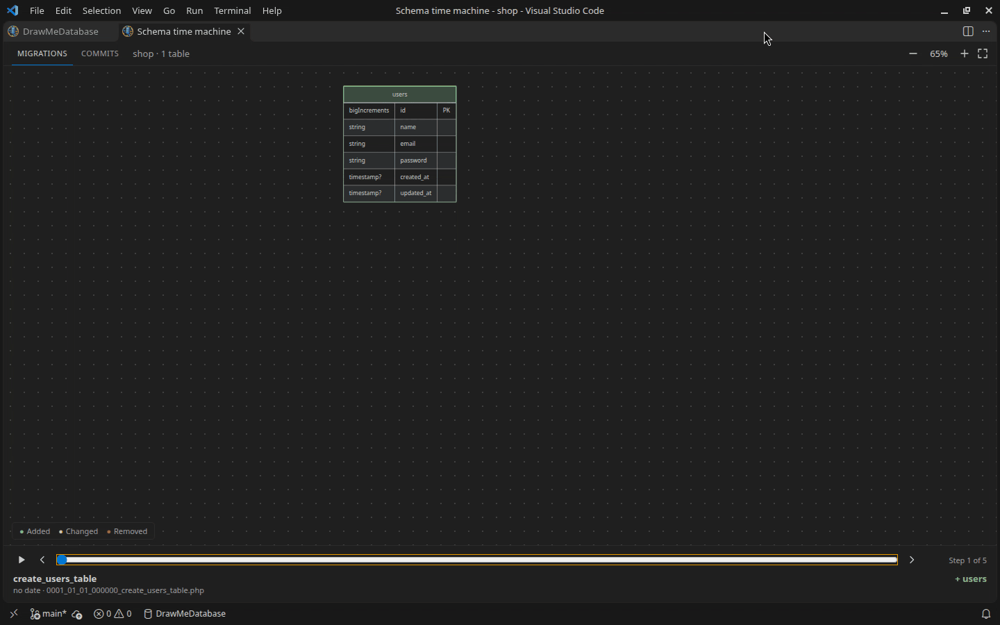

**v1.8.0**

## About DrawMeDatabase

**DrawMeDatabase** is a free and user-friendly Visual Studio Code extension designed to simplify database visualization. By leveraging reverse engineering techniques, this extension automatically analyzes your codebase to create clear and comprehensive diagrams representing your database structure. It reads the migrations of Laravel, the Doctrine entities of Symfony, the schema of Prisma, the schema files of Drizzle ORM, and plain SQL: the migrations of Supabase, Flyway, dbmate, golang-migrate, goose... or a dump of the schema.

Whether you're working on a complex project or managing a simple schema, DrawMeDatabase helps you understand the relationships, tables, and fields within your database without requiring manual effort. It’s an ideal tool for developers who want to improve their workflow, debug efficiently, or share a visual representation of their database design with teammates.

With its seamless integration into VSCode, DrawMeDatabase empowers developers to focus more on building and less on deciphering. Best of all, it’s entirely free to use—download it today and bring your database to life through intuitive diagrams!


## Features

**Framework Supported :** Laravel, Symfony, Prisma, Drizzle and SQL (PostgreSQL, MySQL, SQLite)

- **Laravel** (based on migrations): the files of `database/migrations` are replayed in filename order, like `php artisan migrate`. Only `up()` is read.
  - The schema dump of `php artisan schema:dump` (`database/schema/mysql-schema.sql`, `pgsql-schema.sql`...) is loaded first, then the migrations it does not list, as `php artisan migrate` does on a new database: a project whose old migrations were squashed is drawn whole
  - `Schema::create`, `table`, `rename`, `drop`, `dropIfExists` (also through `Schema::connection(...)`)
  - Column types and helpers: `id()`, `timestamps()`, `softDeletes()`, `rememberToken()`, `morphs()`, `uuid()`, `ulid()`...
  - Foreign keys: `foreignId()->constrained()`, `foreignIdFor(Model::class)`, `foreignUuid()`, `foreignUlid()`, `foreign()->references()->on()`
  - Changes: `->change()`, `renameColumn()`, `dropColumn()`, `dropForeign()`...

- **Symfony** (based on Doctrine entities): every entity of `src/Entity` (sub-folders included).
  - PHP 8 attributes (`#[ORM\...]`) and legacy Doctrine annotations (`@ORM\...`)
  - Table and column names follow Symfony's default naming strategy, or `ORM\Table` / `ORM\Column` names
  - Relations: `ManyToOne`, `OneToOne` and `ManyToMany` (`targetEntity` is optional, as generated by `make:entity`)

- **Prisma** (based on the Prisma schema, Prisma ORM 5 to 7): `schema.prisma`, `prisma/schema.prisma`, a multi-file schema folder (`prisma/schema/`), or the schema set in `prisma.config.ts` or in the `prisma` section of `package.json`. PostgreSQL, MySQL, SQLite, SQL Server and CockroachDB.
  - The tables `prisma migrate` creates: `@@map` and `@map` names, `@@schema` (several database schemas), the Prisma types (`String`, `DateTime`, enums, `Unsupported("...")`), optional fields and scalar lists, `@id` / `@@id`, `@unique` / `@@unique`, `@@index`, `@@fulltext`, `@default`, the native types (`@db.VarChar(255)`, `@db.Decimal(10, 2)`...)
  - Relations from `@relation(fields: [...], references: [...])`: many-to-one, one-to-one (unique fields), composite and self relations, and the join tables of the implicit many-to-many relations (`_CategoryToPost`, or `_Name` for `@relation("Name")`), with their `onDelete` / `onUpdate`
  - Checked against `prisma migrate diff` on the schemas of Cal.diy, Dub, Umami, Hoppscotch and Prisma's examples: the same tables, columns, keys, indexes and join tables

- **Drizzle** (based on the Drizzle ORM schema, drizzle-orm 0.x and 1.0): the schema files that `drizzle.config.ts` sets (a file, a folder, a glob or a list of them; `./src/db/**`: the folder and its sub-folders, as drizzle-kit reads it), else `src/db/schema.ts`, `src/schema.ts`, `db/schema.ts`, `drizzle/schema.ts` or a schema folder, and the files they import (ES modules or CommonJS). The TypeScript is read, never run. PostgreSQL, MySQL, SQLite (and Turso) and SingleStore.
  - The tables drizzle-kit creates: the exported `pgTable()`, `mysqlTable()`, `sqliteTable()` and `singlestoreTable()`, `pgSchema('auth').table()`, the prefix of a table creator (`pgTableCreator()`); the column names (the first argument, else the key with the `casing` of `drizzle.config.ts`, or `snakeCase.table()` of drizzle-orm 1.0); the types (the column builders, `pgEnum`, `mysqlEnum`, custom types), `.notNull()`, `.primaryKey()`, `primaryKey({ columns })`, `.unique()`, the indexes, defaults and lengths
  - Columns written in a callback (`(t) => ({ id: t.integer() })`), spread from an object or a function of the same file or of another one (`...timestamps`, a key written again replacing the column as in JavaScript), or made by a helper of the project (`id: idColumn()`, the default values of its parameters, destructured too, and its local variables, with what its statements add to them before the `return`: `cols.extra = text()`, `list.push(index().on(t.a))`, `Object.assign()`); keys and indexes returned by a helper of the extra config (`(t) => [...tenantKeys(t)]`), whose changes mark the table modified
  - Relations from `.references(() => users.id, { onDelete })` and `foreignKey({ columns, foreignColumns })`: many-to-one or one-to-one (unique columns, not a partial unique index), composite, self and circular references (`(): AnyPgColumn => ...`), the Supabase `authUsers` of `drizzle-orm/supabase` (`auth.users`)
  - Checked against drizzle-kit on the schemas of create-t3-app, Next.js SaaS Starter, Vercel's Chatbot, Cap, OpenStatus and Midday: the same tables, columns, keys, indexes and foreign keys

- **SQL** (based on SQL files, PostgreSQL first, MySQL and SQLite): the migrations of a SQL migration tool, replayed in the order the tool applies them, or a dump of the schema. The SQL is read, never run, and no database is needed.
  - Supported layouts: Supabase (`supabase/migrations/<timestamp>_<name>.sql`), Flyway (`V<version>__<name>.sql` in `src/main/resources/db/migration`, `db/migration` or `sql`, by version; the repeatable `R__` ones are left out), dbmate (`db/migrations`, the `-- migrate:up` section), golang-migrate (`<version>_<name>.up.sql`), goose (`-- +goose Up`), diesel (`migrations/<name>/up.sql`), numbered migrations (`migrations/001_name.sql`: sqlx, Atlas...), Rails `db/structure.sql`, a dump (`schema.sql`, `structure.sql`, `dump.sql`... at the root or in `db/`: pg_dump, mysqldump, `sqlite3 .schema`; its data, `INSERT` and `COPY`, is skipped without being read: a dump of 100 MB is drawn in about half a second). The output of `prisma migrate` (`prisma/migrations`) and of drizzle-kit (`drizzle/`, in the order of its journal) is read when the project has no Prisma or Drizzle schema, or with `DrawMeDatabase.framework` set to `sql`. Set `DrawMeDatabase.frameworkPath` to a folder of migrations elsewhere
  - `CREATE TABLE` (types with their length and precision, `NOT NULL`, `DEFAULT`, primary keys, `UNIQUE`, `REFERENCES` and `FOREIGN KEY` with `ON DELETE` / `ON UPDATE`), `CREATE TYPE ... AS ENUM` and `ALTER TYPE`, `CREATE [UNIQUE] INDEX`, `ALTER TABLE` (columns added, dropped, changed and renamed, constraints added and dropped, `RENAME TO`, `SET SCHEMA`), `INHERITS` (the tables that inherit a parent follow the changes of its columns), `DROP TABLE`, `DROP SCHEMA ... CASCADE`; schema-qualified and quoted names, the search path (`SET`, `RESET`, `SET LOCAL`), comments, dollar-quoted bodies, the DDL of `DO` blocks, transactions. Functions, triggers, policies, grants, extensions, views and data are passed over
  - MySQL: backticks, `AUTO_INCREMENT`, `ENGINE=...`, inline `KEY`, `INDEX`, `UNIQUE KEY` and `CONSTRAINT`, `MODIFY`, `CHANGE`, `FIRST` / `AFTER`, `RENAME TABLE`, `DELIMITER` and the executable comments of mysqldump, a dump of several databases (`USE`: the tables after the first database are prefixed with theirs; the databases of the server, `mysql` and `sys`, that `mysqldump --all-databases` dumps are not drawn). SQLite: `AUTOINCREMENT`, `WITHOUT ROWID`, the tables that prisma migrate and drizzle-kit rebuild to change them
  - A click on a table opens its `CREATE TABLE`, on a column the statement that declared or last changed it; the git status follows the migrations (a new migration marks the tables it changes as modified)
  - Checked against PostgreSQL 17, MySQL 8.4 and SQLite on the migrations of Chatbot UI, Basejump, Next.js Subscription Payments, Harness, OpenFGA, Umami (prisma migrate), OpenStatus (drizzle-kit), Atala PRISM (Flyway), and the dumps of Feedbin (Rails), Pagila, listmonk, Sakila and GitLab: the same tables, columns, keys, foreign keys and indexes as the database

**Diagram viewer:**

- Mermaid 12 entity-relationship diagram: columns with their type (`type?` when nullable), primary and foreign keys, one-to-many / one-to-one / many-to-many relations
- In the colors of your VS Code theme (light, dark, high contrast or any other), or light or dark whatever the VS Code theme
- Zoom and pan: drag to move, Ctrl (Cmd on macOS) + mouse wheel or pinch to zoom, buttons to zoom in, zoom out, fit to window and show at 100 %
- Two layouts: ELK (compact, right-angled links, the default) or Dagre (curved links), top to bottom or left to right
- Export as SVG, PNG, Mermaid source (`.mmd`) or Markdown, or copy the Mermaid source
- Click on a table to inspect it, in a panel of its own: its columns with their keys and types (a click opens the line of a column), the tables it references and the tables that reference it, its git status and the file it comes from. Double-click opens its migration, entity or model

  

- Search: keep the tables whose name or columns contain a text, with the tables they are linked to
- Live: the diagram follows what you type in a migration (PHP or SQL), an entity, a Prisma schema or a Drizzle schema file (and the files its columns come from), before you save it
- Git status of the tables: new, modified, and changed in an editor but not saved yet, in the colors of the git decorations of VS Code (when the project is a git repository)

**DrawMeDatabase in the Activity Bar** (the database icon), like GitLens:

- **Schema**: the tables of the project and their columns (keys, types, foreign keys, git status), read from the code without opening the diagram. A click opens the migration, the entity or the model, or the line of a column; *Show in Diagram* selects the table in the diagram
- **Tools** and **Exports**: the exports of the diagram, and the tools and exports of DrawMeDatabase Pro, greyed with PRO until it is installed
- **License**: the state of DrawMeDatabase Pro, once it is installed
- Without a supported project, the Schema view tells why and how to set the framework folder



**Options panel** of the diagram (the panel button at the right of the toolbar): everything about the diagram in one place, saved in your settings.

- **Diagram**: layout, direction, git status, keys only (primary and foreign keys), relation names, background grid
- **Appearance**: like VS Code, light or dark whatever the VS Code theme, and the size of the text. The palettes, your own colors and the fonts come with DrawMeDatabase Pro
- **Settings**: English or French, or the language of VS Code (the diagram, the views, the messages, and the commands and settings of VS Code), live refresh, the framework folder


**JSON viewer:** the parsed schema, colored like code, to save or copy.

**Code-Driven Visualization**: 

    Automatically analyzes your codebase to create detailed and accurate diagrams, saving time and effort. No database connection is needed, and everything works offline.

## DrawMeDatabase Pro

DrawMeDatabase is free, and everything it does today stays free. **DrawMeDatabase Pro** is a separate, paid extension that adds tools on top of it:

- **Git status of every column**, live: the new, modified and unsaved columns in the diagram and in the inspector
- **Inspector of the tables**: the columns in detail (sizes, defaults, enum values, comments), the indexes, the foreign keys with their `ON DELETE`, the history of the table (migrations, commits, authors, dates) and actions
- **Your colors**: palettes in a light and a dark version, custom colors (background, headers, text, borders, links, highlight, git status) and fonts
- **Schema time machine**: replay the history of the schema, migration after migration or commit after commit, with what each step added, changed or removed
- **Schema canvas**: a second view where you move the tables and the links by hand, with the git status of every column; the layout is kept and can be shared with your team
- **Table designer**: draw a table (columns, types, keys, relations) and get the Laravel migration or the Doctrine entity written for you
- **Schema comparison**: what changed between two branches or commits, and what a migration does, with a report to paste in a pull request
- **Database drift**: the code compared with a real MySQL, MariaDB, PostgreSQL or SQLite database — the migrations never run, the columns changed by hand, the indexes and foreign keys that differ (read only)
- **Exports**: SQL (MySQL, PostgreSQL, SQLite), DBML, PlantUML, TypeScript types, and an HTML documentation of the schema
- **Schema checks** in the Problems panel: missing primary or foreign keys, mismatched types, naming...
- **Large schemas**: the path between two tables, saved views shared with your team
- **Laravel**: Eloquent models with their relationships, generated from the schema




It has a free 14-day trial. Search for "DrawMeDatabase Pro" in the Extensions view.

## Usage

Open your project, then click **DrawMeDatabase** in the status bar (or run `DrawMeDatabase: Draw Database Schema` from the Command Palette, or click the diagram button of the Schema view in the DrawMeDatabase sidebar).

In the panel:

- **Diagram** and **JSON** tabs switch between the viewers
- The toolbar changes the layout and the direction, zooms, exports and refreshes the diagram after you changed your code (also `DrawMeDatabase: Refresh Diagram`, or the refresh button in the title bar of the panel)
- Keyboard, once the diagram has the focus: `+` and `-` to zoom, `0` for 100 %, `F` to fit, arrows to move
- `Ctrl+F` (`Cmd+F` on macOS) goes to the search box, `Escape` clears it
- A click on a table opens the file it comes from; the exports and the JSON viewer follow the search

**Settings:**

- `DrawMeDatabase.frameworkPath`: path to the framework folder, relative to the workspace folder. Leave it empty if the framework is at the root of the workspace. Example: `my-project/app/symfony`
- `DrawMeDatabase.framework`: `auto` (default) detects the framework of the project; `laravel`, `symfony`, `prisma`, `drizzle` or `sql` chooses it, for a project that matches several of them (the **DrawMeDatabase** output lists the frameworks found). `sql` also draws the history of a Prisma or Drizzle project from its SQL migrations
- `DrawMeDatabase.layout`: `elk` (default) or `dagre`
- `DrawMeDatabase.direction`: `TB` (top to bottom, default) or `LR` (left to right)
- `DrawMeDatabase.autoRefresh`: draw the open diagram again while you edit a migration, an entity, the Prisma schema, a Drizzle schema file or a SQL file, and when one is saved, created, deleted or committed (default: on)
- `DrawMeDatabase.showGitStatus`: show the git status of the tables in the diagram (default: on, also the **Git** button of the toolbar)
- `DrawMeDatabase.keysOnly`, `DrawMeDatabase.relationLabels`: only the keys of each table, the names of the relations (also in the options panel)
- `DrawMeDatabase.language`: `auto` (the language of VS Code), `en` or `fr`
- `DrawMeDatabase.theme`, `DrawMeDatabase.palette`, `DrawMeDatabase.colors`, `DrawMeDatabase.font`, `DrawMeDatabase.customFont`, `DrawMeDatabase.fontSize`, `DrawMeDatabase.grid`: the appearance of the diagram, easier to change from the options panel

Details and warnings (for example a table whose name cannot be read) are written in the **DrawMeDatabase** output panel.

## Known limitations

DrawMeDatabase reads your code, it does not execute it nor connect to a database:

- **Laravel**
  - Conditional code (`if`, loops, `Schema::whenTableHasColumn()`...) is applied as if every branch ran. Names computed at runtime (`config()`, variables, concatenations) are skipped, with a warning.
  - Only the top-level files of `database/migrations` are read: sub-folders and package migrations (`loadMigrationsFrom()`) are not.
  - A schema dump is read for the default connection (`DB_CONNECTION` of `.env`, else the default of `config/database.php`, else the only dump; a warning names the one read when several dumps exist). Its tables have the SQL types of the dump (`varchar`, `bigint`), the migrations after it the Blueprint types (`string`). A binary dump (`pg_dump --format=custom`, Laravel 8) is not read. With the time machine of DrawMeDatabase Pro, the schema after a migration that the dump lists is replayed from the migration files alone.
  - Relations come from foreign key constraints only (`constrained()`, `foreign()->references()->on()`), not from Eloquent models. Without a table name, `constrained()` guesses it like Laravel (plural of the column name) and `foreignIdFor(Model::class)` assumes the model's default table and key.
- **Symfony**
  - Only the attributes and annotations of `src/Entity` are read: XML/YAML mappings, other mapping folders, and traits or parent classes declared elsewhere (for example Gedmo's `TimestampableEntity`) are not. A warning names each trait or parent class that could not be read.
  - Embeddables are not shown, and Symfony's default naming strategy is assumed.
  - Backed enums declared outside `src/Entity` are shown as `string`.
- **Prisma**
  - The schema path of `prisma.config.ts` is read without running the file: the `schema` of the object given to `defineConfig()` or exported, a string, or `path.join()` / `path.resolve()` of strings and `__dirname`. A computed path (an environment variable, a config built by a function...) is named in the output, and the default locations are read instead.
  - In a monorepo, set `DrawMeDatabase.frameworkPath` to the folder of the Prisma project: a folder whose `package.json` only lists `prisma` or `@prisma/client`, without a schema, is not taken for a Prisma project. A schema that `prisma.config.ts` sets outside of that folder is read and opened from the diagram too.
  - Prisma 7 no longer reads `prisma.schema` of `package.json`: for a Prisma 7 project, it is read only when there is no schema at a default location, with a warning.
  - MongoDB projects (`provider = "mongodb"`) have no tables: nothing is drawn. Views (`view`) and composite types (`type`) are not drawn either, with a warning.
  - The types are those of Prisma (`String`, `DateTime`, the name of an enum): the native type of the database (`@db.VarChar(255)`) is in the details, for the exports of DrawMeDatabase Pro and the API. Scalar lists are drawn `String[]?`, as `prisma migrate` creates them nullable.
  - Models and fields with `@@ignore` / `@ignore` are drawn: `prisma migrate` still creates them. With `relationMode = "prisma"`, the relations are drawn although the database has no foreign key.
  - The values that Prisma Client generates (`uuid()`, `cuid()`, `@updatedAt`...) and the defaults of scalar lists (`@default([])`) are not given as defaults.
  - Prisma 8 (`contract.prisma`, a release candidate) is not read yet. The SQL of `prisma/migrations` is drawn with `DrawMeDatabase.framework` set to `sql`.
- **Drizzle**
  - The schema files and `drizzle.config.ts` are read, not run: a table name, a column name, a schema path or a casing computed at run time (an environment variable, a function of a package) is named in the output, and the table is skipped (the key names the column, the usual locations are read). The helpers of a package (not of the project) are not read, nor a helper with several `return`, nor a local variable changed in a condition, a loop or a callback (`if (flag) list.push(...)`): their columns, keys and indexes are skipped with a warning, as is a helper of the extra config that spreads itself (it never ends when run). As drizzle-kit, an object in the array of the extra config (`[{ pk: primaryKey(...) }]`) or an array nested twice is ignored, with a warning.
  - As drizzle-kit, only the exported tables are drawn (a table that is not exported is named in the output), and not the tables of a `mysqlSchema()` (another database). Views are not drawn.
  - `relations()` and `defineRelations()` are the relations of the ORM, not foreign keys: a relation without `.references()` or `foreignKey()` is not drawn.
  - The types are the names of the column builders (`varchar`, `timestamp`, `serial`): the options that change the SQL type (`withTimezone`, `mode`) are not shown. The `{ enum: [...] }` of a text column only types it in TypeScript: its values are not given.
  - The casing set in the code of the app (`drizzle({ casing })`) is not read: drizzle-kit reads the one of `drizzle.config.ts`. drizzle-kit 1.0 ignores that one, and DrawMeDatabase too, with a warning (`snakeCase.table()` sets it).
  - Imports are followed through relative paths and the path aliases of `tsconfig.json` (not those of a `tsconfig.json` it extends), not into the packages of a monorepo. The SQL migrations of drizzle-kit are drawn with `DrawMeDatabase.framework` set to `sql`.
- **SQL**
  - The SQL is read, not run: procedural code is applied as if every branch ran (the DDL of the branches of a `DO` block, not of its exception handlers), dynamic SQL (`EXECUTE format(...)`) is skipped with a warning, the bodies of functions and triggers are never applied. Views, materialized views, partitions, sequences, virtual tables (SQLite FTS) and temporary tables are not drawn, nor the tables of the migration tools (`schema_migrations`, `flyway_schema_history`, `_prisma_migrations`...).
  - Tables created outside of the files (in the Supabase dashboard, by the application) are missing: an `ALTER TABLE` of such a table adds it with the columns it adds, with a warning, and a foreign key to it (`auth.users`) draws it without columns.
  - The types are those of the SQL, as written (`character varying`, `int4`, `timestamptz`): they are not normalized. Unquoted names are folded to lower case on PostgreSQL only. The dialect is read from the files (or the lock file of prisma migrate, the journal of drizzle-kit, a folder named `postgres`, `mysql`, `sqlite`); SQL that does not tell it is read as PostgreSQL, without folding the names.
  - Only the first layout found is read (migrations before a dump). dbmate's `db/schema.sql` is read only without migrations, Flyway's repeatable migrations (`R__`) and Liquibase changelogs are not read, nor T-SQL (`GO`, `[dbo]`). Each migration file starts with the default search path (`public`), and a `SET LOCAL` outside `BEGIN` lasts until the end of the file, which the migration tools run in a transaction.
  - Flyway placeholders are not given their value: one written as the schema of a name (`${schema}.users`, `${flyway:defaultSchema}.users`) is read as the default schema, the others are left as they are (a `CREATE TABLE ${table}` is not understood, with a warning).
  - MySQL: a `REFERENCES` written on a column draws no relation, as MySQL 8.4 ignores it (with a warning that tells to write `FOREIGN KEY (column) REFERENCES ...`), unless the SQL is MariaDB's (a MariaDB dump, or migrations in a `mariadb` folder). The index that MySQL creates for a foreign key is not drawn.
- **Every framework**
  - The diagram shows the column type, the primary key and the nullable flag. Lengths, default values, indexes and `ON DELETE` are read too, for the exports of DrawMeDatabase Pro and the API (`details` option). Many-to-many join tables are drawn as a single link.
  - In the diagram, characters that Mermaid cannot read in an attribute name or type (spaces, `$`, `#`...) are replaced with `_` (the JSON viewer always shows the exact names).
  - Very large schemas (hundreds of tables) take a few seconds to draw.
  - The extension does not run in Restricted Mode (untrusted workspaces) or in virtual workspaces.

## Development

Node.js 22 or later is required.

```bash
npm install            # also copies the bundled Mermaid library into views/vendor
npm run lint
npm run test:unit      # parsers and viewers, no VS Code needed
npm test               # lint + unit tests + integration tests in VS Code (on Linux: xvfb-run -a npm test)
VSCODE_TEST_VERSION=1.96.0 npm test   # the same on another VS Code version (default: stable)
npm run package        # builds builds/draw-me-database-<version>.vsix
```

Each framework has a parser in `parsers/`, listed in `parsers/registry.js`: to add one, see [docs/parsers.md](docs/parsers.md) (the parser contract) and [docs/pivot-format.md](docs/pivot-format.md) (what it returns).

GitHub Actions runs these checks on every pull request, the integration tests also on the oldest VS Code version allowed by `engines.vscode`, and keeps the `.vsix` as an artifact. Releases are published from a version tag to GitHub Releases and Open VSX; the VS Code Marketplace is updated by hand. See [docs/publishing.md](docs/publishing.md).

## Changelog

Latest release : **v1.8.0**
For a detailed list of changes, please refer to the [CHANGELOG.md](CHANGELOG.md) file.
