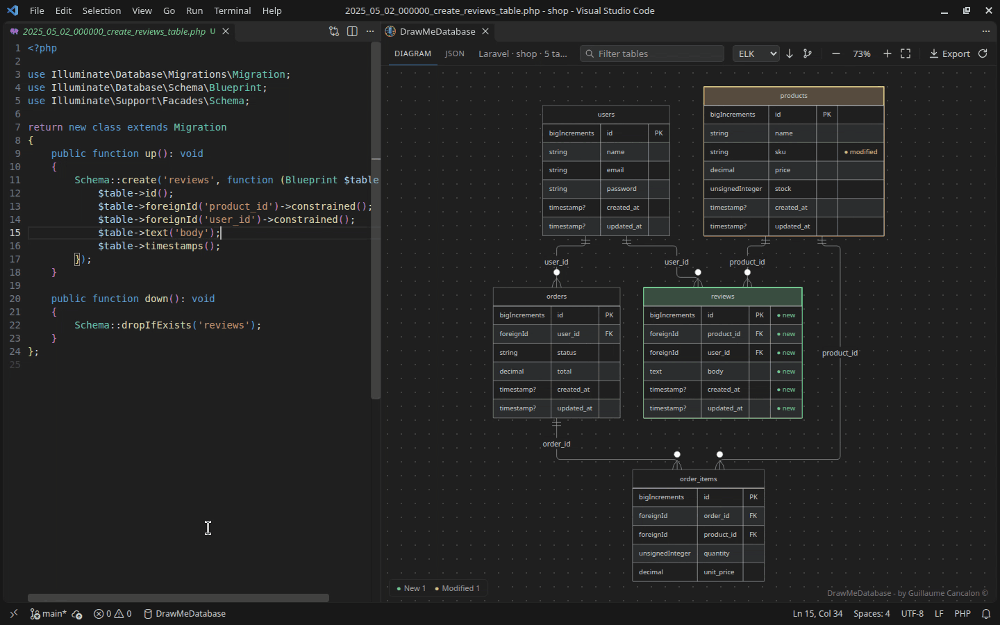
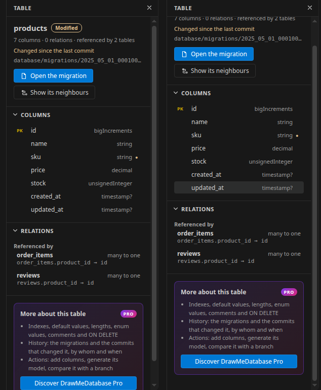
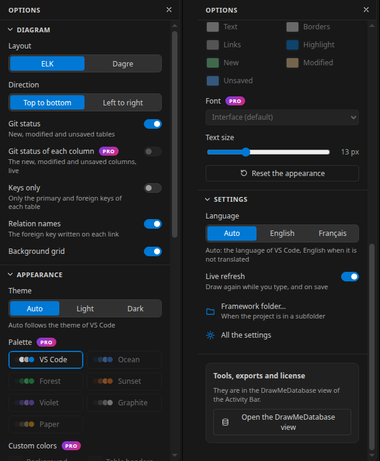
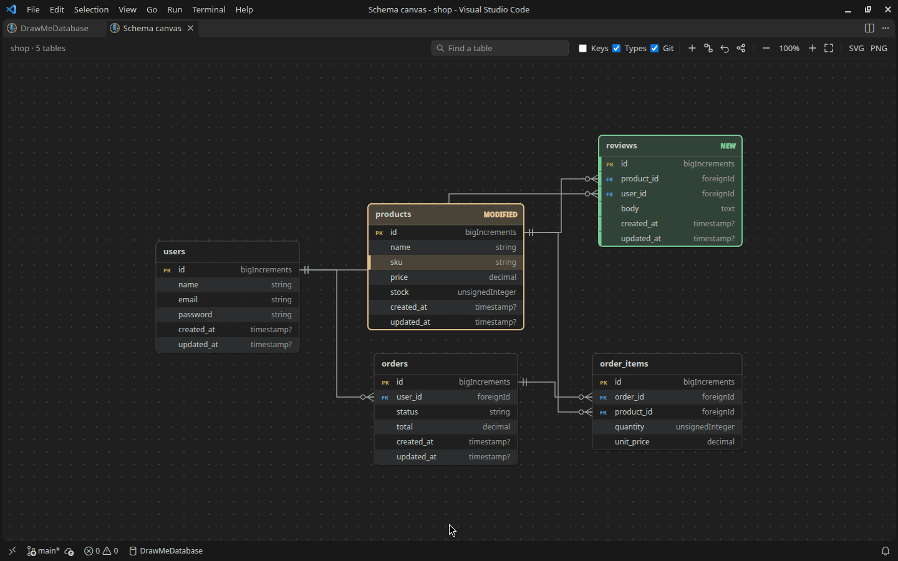
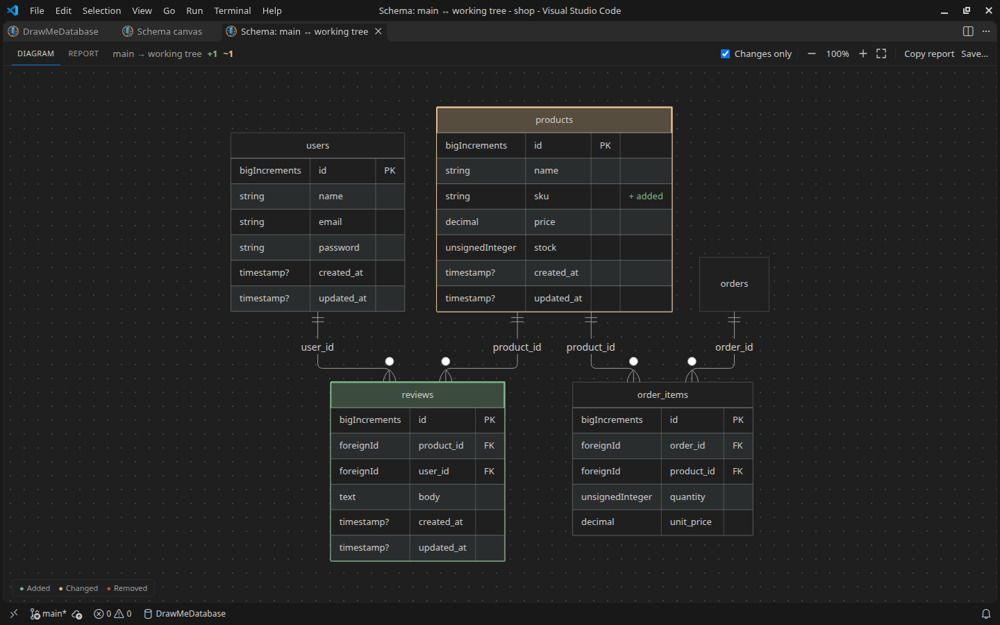
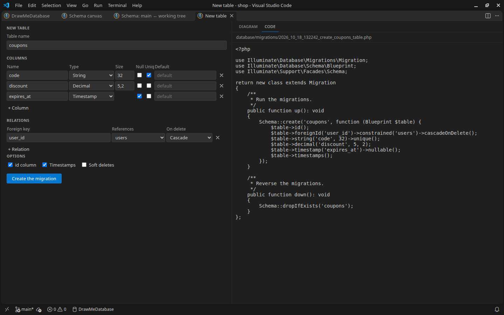

**v1.6.0**

## About DrawMeDatabase

**DrawMeDatabase** is a free and user-friendly Visual Studio Code extension designed to simplify database visualization. By leveraging reverse engineering techniques, this extension automatically analyzes your codebase to create clear and comprehensive diagrams representing your database structure.

Whether you're working on a complex project or managing a simple schema, DrawMeDatabase helps you understand the relationships, tables, and fields within your database without requiring manual effort. It’s an ideal tool for developers who want to improve their workflow, debug efficiently, or share a visual representation of their database design with teammates.

With its seamless integration into VSCode, DrawMeDatabase empowers developers to focus more on building and less on deciphering. Best of all, it’s entirely free to use—download it today and bring your database to life through intuitive diagrams!



## Features

**Framework Supported :**

- **Laravel** (based on migrations): the files of `database/migrations` are replayed in filename order, like `php artisan migrate`. Only `up()` is read.
  - `Schema::create`, `table`, `rename`, `drop`, `dropIfExists` (also through `Schema::connection(...)`)
  - Column types and helpers: `id()`, `timestamps()`, `softDeletes()`, `rememberToken()`, `morphs()`, `uuid()`, `ulid()`...
  - Foreign keys: `foreignId()->constrained()`, `foreignIdFor(Model::class)`, `foreignUuid()`, `foreignUlid()`, `foreign()->references()->on()`
  - Changes: `->change()`, `renameColumn()`, `dropColumn()`, `dropForeign()`...

- **Symfony** (based on Doctrine entities): every entity of `src/Entity` (sub-folders included).
  - PHP 8 attributes (`#[ORM\...]`) and legacy Doctrine annotations (`@ORM\...`)
  - Table and column names follow Symfony's default naming strategy, or `ORM\Table` / `ORM\Column` names
  - Relations: `ManyToOne`, `OneToOne` and `ManyToMany` (`targetEntity` is optional, as generated by `make:entity`)

**Diagram viewer:**

- Mermaid 12 entity-relationship diagram: columns with their type (`type?` when nullable), primary and foreign keys, one-to-many / one-to-one / many-to-many relations
- In the colors of your VS Code theme (light, dark, high contrast or any other), or in your own: see the options panel
- Zoom and pan: drag to move, Ctrl (Cmd on macOS) + mouse wheel or pinch to zoom, buttons to zoom in, zoom out, fit to window and show at 100 %
- Two layouts: ELK (compact, right-angled links, the default) or Dagre (curved links), top to bottom or left to right
- Export as SVG, PNG, Mermaid source (`.mmd`) or Markdown, or copy the Mermaid source
- Click on a table to inspect it: its columns with their keys, types and git status (a click opens the line of a column), the tables it references and the tables that reference it, the file it comes from. Double-click opens its migration or entity

  

- Search: keep the tables whose name or columns contain a text, with the tables they are linked to
- Live: the diagram follows what you type in a migration or an entity, before you save it
- Git status: new, modified and unsaved tables and columns, in the colors of the git decorations of VS Code (Laravel and Symfony, when the project is a git repository)

**Options panel** (the panel button at the right of the toolbar): everything in one place, saved in your settings.

- **Diagram**: layout, direction, git status, keys only (primary and foreign keys), relation names, background grid
- **Appearance**: like VS Code, light or dark whatever the VS Code theme; palettes (Ocean, Forest, Sunset, Violet, Graphite, Paper) in a light and a dark version; your own colors for the background, the table headers, the text, the borders, the links, the highlight and the git status; the font and the size of the text
- **Language**: English or French, or the language of VS Code (the diagram, the messages, and the commands and settings of VS Code)
- **Tools and exports** of DrawMeDatabase Pro, greyed with a PRO badge until it is installed, and the state of its license



**JSON viewer:** the parsed schema, colored like code, to save or copy.

**Code-Driven Visualization**: 

    Automatically analyzes your codebase to create detailed and accurate diagrams, saving time and effort. No database connection is needed, and everything works offline.

## DrawMeDatabase Pro

DrawMeDatabase is free, and everything it does today stays free. **DrawMeDatabase Pro** is a separate, paid extension that adds tools on top of it:

- **Schema canvas**: a second view where you move the tables and the links by hand, with the git status of every column; the layout is kept and can be shared with your team
- **Table designer**: draw a table (columns, types, keys, relations) and get the Laravel migration or the Doctrine entity written for you
- **Schema comparison**: what changed between two branches or commits, and what a migration does, with a report to paste in a pull request
- **Exports**: SQL (MySQL, PostgreSQL, SQLite), DBML, PlantUML, TypeScript types, and an HTML documentation of the schema
- **Schema checks** in the Problems panel: missing primary or foreign keys, mismatched types, naming...
- **Large schemas**: the path between two tables, saved views shared with your team
- **Laravel**: Eloquent models with their relationships, generated from the schema







It has a free 14-day trial. Search for "DrawMeDatabase Pro" in the Extensions view.

## Usage

Open your project, then click **DrawMeDatabase** in the status bar (or run `DrawMeDatabase: Draw Database Schema` from the Command Palette).

In the panel:

- **Diagram** and **JSON** tabs switch between the viewers
- The toolbar changes the layout and the direction, zooms, exports and refreshes the diagram after you changed your migrations or entities (also `DrawMeDatabase: Refresh Diagram`, or the refresh button in the title bar of the panel)
- Keyboard, once the diagram has the focus: `+` and `-` to zoom, `0` for 100 %, `F` to fit, arrows to move
- `Ctrl+F` (`Cmd+F` on macOS) goes to the search box, `Escape` clears it
- A click on a table opens the file it comes from; the exports and the JSON viewer follow the search

**Settings:**

- `DrawMeDatabase.frameworkPath`: path to the framework folder, relative to the workspace folder. Leave it empty if the framework is at the root of the workspace. Example: `my-project/app/symfony`
- `DrawMeDatabase.layout`: `elk` (default) or `dagre`
- `DrawMeDatabase.direction`: `TB` (top to bottom, default) or `LR` (left to right)
- `DrawMeDatabase.autoRefresh`: draw the open diagram again while you edit a migration or an entity, and when one is saved, created, deleted or committed (default: on)
- `DrawMeDatabase.showGitStatus`: show the git status of the tables and columns in the diagram (default: on, also the **Git** button of the toolbar)
- `DrawMeDatabase.keysOnly`, `DrawMeDatabase.relationLabels`: only the keys of each table, the names of the relations (also in the options panel)
- `DrawMeDatabase.language`: `auto` (the language of VS Code), `en` or `fr`
- `DrawMeDatabase.theme`, `DrawMeDatabase.palette`, `DrawMeDatabase.colors`, `DrawMeDatabase.font`, `DrawMeDatabase.customFont`, `DrawMeDatabase.fontSize`, `DrawMeDatabase.grid`: the appearance of the diagram, easier to change from the options panel

Details and warnings (for example a table whose name cannot be read) are written in the **DrawMeDatabase** output panel.

## Known limitations

DrawMeDatabase reads your code, it does not execute it nor connect to a database:

- **Laravel**
  - Conditional code (`if`, loops, `Schema::whenTableHasColumn()`...) is applied as if every branch ran. Names computed at runtime (`config()`, variables, concatenations) are skipped, with a warning.
  - Only the top-level files of `database/migrations` are read: sub-folders, package migrations (`loadMigrationsFrom()`) and schema dumps (`database/schema/*.sql`) are not.
  - Relations come from foreign key constraints only (`constrained()`, `foreign()->references()->on()`), not from Eloquent models. Without a table name, `constrained()` guesses it like Laravel (plural of the column name) and `foreignIdFor(Model::class)` assumes the model's default table and key.
- **Symfony**
  - Only the attributes and annotations of `src/Entity` are read: XML/YAML mappings, other mapping folders, and traits or parent classes declared elsewhere (for example Gedmo's `TimestampableEntity`) are not. A warning names each trait or parent class that could not be read.
  - Embeddables are not shown, and Symfony's default naming strategy is assumed.
  - Backed enums declared outside `src/Entity` are shown as `string`.
- **Both**
  - The diagram shows the column type, the primary key and the nullable flag. Lengths, default values, indexes and `ON DELETE` are read too, for the exports of DrawMeDatabase Pro and the API (`details` option). Many-to-many join tables are drawn as a single link.
  - In the diagram, characters that Mermaid cannot read in an attribute name or type (spaces, `$`, `#`...) are replaced with `_` (the JSON viewer always shows the exact names).
  - Very large schemas (hundreds of tables) take a few seconds to draw.
  - The extension does not run in Restricted Mode (untrusted workspaces) or in virtual workspaces.

## Development

Node.js 22 or later is required.

```bash
npm install            # also copies the bundled Mermaid library into views/vendor
npm run lint
npm run test:unit      # parsers and viewers, no VS Code needed
npm test               # lint + unit tests + integration tests in VS Code (on Linux: xvfb-run -a npm test)
VSCODE_TEST_VERSION=1.96.0 npm test   # the same on another VS Code version (default: stable)
npm run package        # builds builds/draw-me-database-<version>.vsix
```

GitHub Actions runs these checks on every pull request, the integration tests also on the oldest VS Code version allowed by `engines.vscode`, and keeps the `.vsix` as an artifact. Releases are published from a version tag to GitHub Releases and Open VSX; the VS Code Marketplace is updated by hand. See [docs/publishing.md](docs/publishing.md).

## Changelog

Latest release : **v1.6.0**
For a detailed list of changes, please refer to the [CHANGELOG.md](CHANGELOG.md) file.
